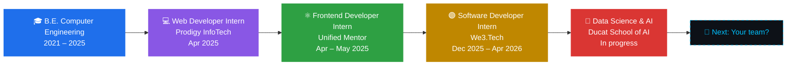
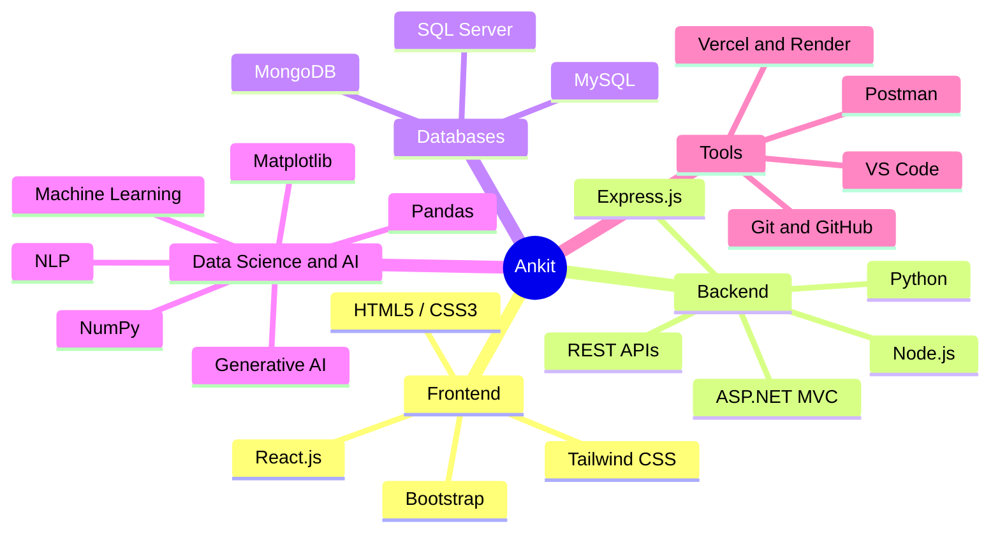

<!-- ============ HEADER BANNER ============ -->

 

---

## 👋 About Me

I'm a **Computer Engineering graduate** from Theem College of Engineering based in **Mumbai, India**. I build scalable, user-focused web applications with the **MERN stack** and **ASP.NET MVC**, and I enjoy turning ideas into clean, maintainable, production-ready features.

I'm now expanding into **Data Science and AI** (Python, SQL, Machine Learning, Deep Learning, NLP, Generative AI) through my certification at **Ducat School of AI**, so I can combine full-stack engineering with intelligent features.

| | |
|---|---|
| 💼 **Experience** | .NET Developer at We3.Tech, Frontend Developer at Unified Mentor, Web Developer Intern at Prodigy InfoTech |
| 🔭 **Learning now** | Machine Learning, Neural Networks, NLP, LangChain, OpenAI API |
| 🎯 **Looking for** | Full Stack, Frontend and .NET Developer roles |
| 📍 **Location** | Mumbai, Maharashtra, India |

---

## 🧭 My Journey

---

## 🧠 Skills Map

---

## 💼 Experience Highlights

| Role | Company | Period | Impact |
|------|---------|--------|--------|
| **.NET Developer** | We3.Tech | Dec 2025 – Apr 2026 | Built features with C#, ASP.NET MVC and SQL Server; wrote stored procedures to speed up data retrieval; connected frontend components with backend logic |
| **Frontend Web Developer** | Unified Mentor | Apr – May 2025 | Built responsive UIs with React.js and Tailwind CSS; created reusable components; managed state with React hooks |
| **Web Developer Intern** | Prodigy InfoTech | Apr 2025 | Delivered HTML, CSS and JavaScript features on deadline; fixed UI bugs with the team |

---

## 🚀 Featured Projects

<table>
<tr>
<td width="50%" valign="top">

### 📊 LeetMetric App
Tracks and visualizes LeetCode progress with detailed statistics and a problem-solving breakdown by difficulty (Easy, Medium, Hard). Built to keep developers motivated during interview prep.

[View on GitHub →](https://github.com/Ankit4511?tab=repositories)

</td>
<td width="50%" valign="top">

### 📚 Study-Sync
A fully responsive multi-section landing page in HTML and CSS, with features, testimonials and a newsletter sign-up, optimized for every device.

[View on GitHub →](https://github.com/Ankit4511?tab=repositories)

</td>
</tr>
</table>

---

## 💻 Tech Stack

                           

---

## 🎓 Education & Certifications

- 🎓 **B.E. Computer Engineering**, Theem College of Engineering (2021 – 2025)
- 🤖 **Data Science AI Certification**, Ducat School of AI *(in progress)*
- ☁️ **AWS Academy Graduate, Data Engineering** (Oct 2024)
- 📝 **Paper Presentation:** *NFT Bazar Using Blockchain*, THEEM-2025 International Conference
- 🐍 **Workshop:** Data Science Using Python, LiveTech India & Theem College (2023)

---

## 📊 GitHub Stats

---

## 🤝 Let's Connect

I'm actively looking for opportunities where I can contribute to real products and keep growing as an engineer. If you have a role, a project or an idea, I'd love to hear from you.

📧 **ankitsuthar683@gmail.com** · 🌐 **[Portfolio](https://ankit-portfolio-inky.vercel.app)** · 💼 **[LinkedIn](https://linkedin.com/in/ankitkumar-suthar)**

<!-- Proudly created with GPRM ( https://gprm.itsvg.in ) -->
